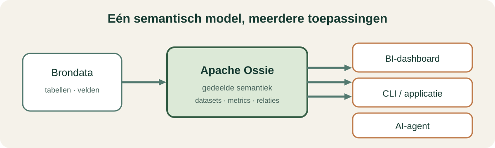
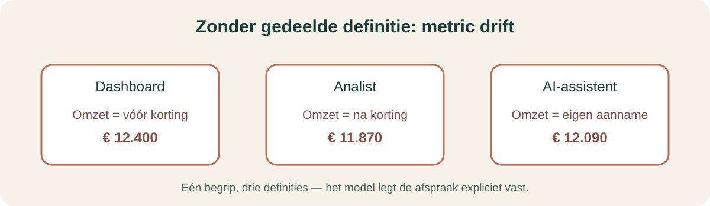
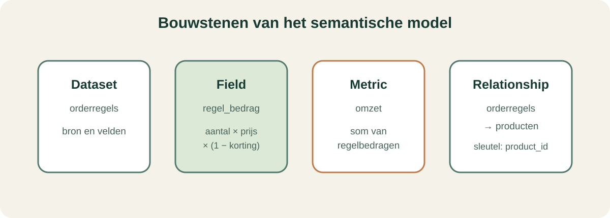
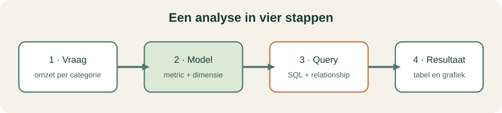

# Minicursus Apache Ossie

**Voor wie:** data-analisten, BI-bouwers en ontwikkelaars  
**Duur:** ongeveer 25 minuten  
**Praktijkvoorbeeld:** bloemenwebshop Knol & Bloei



## Leerdoelen

Na deze minicursus kun je uitleggen wat een semantisch model doet, de belangrijkste onderdelen van het Knol & Bloei-model herkennen en beschrijven hoe een applicatie het model gebruikt om een analyse uit te voeren.

## 1. Het probleem: dezelfde vraag, andere betekenis

Een dashboard, analist en AI-assistent kunnen allemaal “omzet” berekenen. Als iedere tool zelf bepaalt of korting, btw of retouren meetellen, ontstaan verschillende antwoorden. Dat heet metric drift.

Apache Ossie is een open specificatie voor het uitwisselen van semantische metadata. Een model legt onder meer datasets, velden, metrics en relaties vast. Meerdere consumenten kunnen die definities lezen.



**Bespreek:** wat moet “omzet” in jouw organisatie wel en niet bevatten?

## 2. De bouwstenen in het project

Open [`../models/knol_en_bloei.ossie.yaml`](../models/knol_en_bloei.ossie.yaml). Dat bestand beschrijft het semantische model voor de webshop.

| Bouwsteen | Voorbeeld | Betekenis |
|---|---|---|
| Dataset | `orderregels` | Een logisch beschikbare tabel of gegevensbron |
| Field | `regel_bedrag` | Een veld, eventueel berekend uit andere velden |
| Metric | `omzet` | Een meetwaarde die wordt geaggregeerd |
| Relationship | regels → producten | Een verklaarde route voor een koppeling |
| `ai_context` | synoniemen voor omzet | Extra context voor vraaginterpretatie |



In deze demo is `regel_bedrag` gedefinieerd als `aantal * prijs_per_stuk * (1 - korting)`. De metric `omzet` telt die bedragen op. De aparte metric `bruto_omzet` telt vóór korting op. De keuze is dus zichtbaar in het model.

## 3. Van vraag naar resultaat

De demo-consumer in [`../app/ossie_core.py`](../app/ossie_core.py) leest het YAML-model, zoekt de benodigde datasets en relaties, vertaalt de velddefinities naar SQL en voert de query uit op SQLite. De applicatie krijgt de semantische keuzes uit het model.



Probeer in de UI of CLI bijvoorbeeld:

```bash
uv run python scripts/cli_vraag.py --leg
uv run python scripts/cli_vraag.py "wat is de omzet per categorie"
uv run python scripts/cli_vraag.py "gemiddelde orderwaarde per stad"
```

Bekijk de gekozen metric, de gegenereerde SQL en het antwoord. Dezelfde modeldefinitie voedt de desktopdemo en CLI.

## 4. Hoe gebruik je Ossie in een project?

1. **Breng bronnen en begrippen in kaart.** Noteer tabellen, sleutels, definities en eigenaars.
2. **Leg het semantische model vast.** Beschrijf datasets, velden, metrics en relaties in het afgesproken Ossie-formaat.
3. **Valideer het model.** Controleer namen, referenties en scope. Deze demo bevat een minimale validator; controleer voor productie de actuele officiële specificatie en tooling.
4. **Koppel een consumer.** Een BI-tool, applicatie of agent moet het model kunnen lezen en de expressies voor de databron kunnen uitvoeren.
5. **Vergelijk resultaten.** Controleer dezelfde vraag via meerdere consumers en bespreek verschillen met de data-eigenaar.
6. **Beheer wijzigingen.** Behandel wijzigingen aan metricdefinities als betekenisvolle modelwijzigingen en communiceer ze aan gebruikers.

## 5. Wat deze demo wel en niet laat zien

Dit project toont een Ossie-model, voorbeelddata, SQLite, een eenvoudige SQL-compiler, een desktopinterface, een CLI en regelgebaseerde herkenning van vraagtermen uit `ai_context`. De AI-tab is **geen LLM**: het illustreert hoe semantische metadata een vraagmatcher richting kan geven.

De eigen consumer implementeert een leerzame subset en is geen officiële Apache Ossie-SDK. Zie de repo-README en de actuele [Apache Ossie-documentatie](https://ossie.apache.org/) voor de stand van de specificatie en beschikbare implementaties.

## Oefening (5 minuten)

1. Zoek in het YAML `regel_bedrag`, `omzet` en `bruto_omzet`.
2. Leg uit waarom de uitkomsten van de laatste twee kunnen verschillen.
3. Voer “omzet per categorie” uit via de CLI.
4. Wijs in de SQL aan waar de relatie naar `producten` wordt gebruikt.
5. Bedenk een metric die jouw team nodig heeft en benoem welke definitie nog moet worden afgesproken.

## Antwoorden om te bespreken

- `regel_bedrag` trekt de korting af; `bruto_omzet` doet dat niet.
- De categorie staat in `producten`, dus voor deze uitsplitsing is een relatie vanaf `orderregels` nodig.
- Een metric is pas gedeeld begrepen als formule, filters, eenheid en scope helder zijn.
